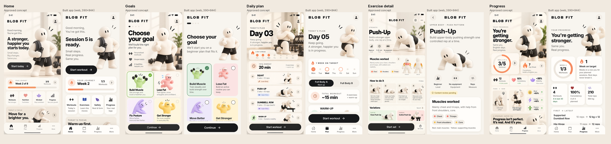

# BLOB FIT — MVP implementation report

**Branch:** `claude/zealous-cannon-9cvkob` · **Date:** 2026-10-17 · **Status:** feature-complete MVP preview. This is not an app-store release.



## Run it

```bash
npm install
npm run web          # Expo dev server in the browser
npm run ios          # Expo Go / simulator (macOS)
npm run android      # Expo Go / emulator
npm run check        # typecheck + lint + unit tests
npm run build:web && npm run e2e   # exported web build + end-to-end smoke test (Playwright)
```

Stack: Expo SDK 58, React Native 0.88, React 19.3, TypeScript 6 (strict), Expo Router (file routes in `src/app/`). Everything runs offline. There is no account, backend, API key, analytics or payment code.

## What works

| Area | Behaviour |
|---|---|
| **Onboarding** | Four steps: goal, experience, training days (2–4, with a warning for three days in a row), equipment, plus a required general-fitness disclaimer. The answers persist across relaunch and can be edited later in *More → Your plan settings*. |
| **Home** | Greeting and a hero whose copy follows today's real state: first session, session N ready, rest day, done today, or resume. Also shows the week's journey card (sessions done vs planned), quick links and a focus card. |
| **Plan** | Beginner full-body A/B rotation. A is squat, incline push-up and a pull; B is hip hinge, a pull and plank. Sets depend on experience. The pull adapts to equipment: dumbbell row, then band row, then prone Y raise. The screen also has week dots (done / planned / missed / rest / extra), a ~duration estimate, an expandable warm-up and A/B preview. Rest days are real days off, and you can still start a workout if you want. |
| **Exercise detail** | Muscles (text chips, no anatomy overlay), starting position, numbered steps, rep phases, form cues, common mistakes, and linked easier/harder variations. Every exercise shows a **Content review pending** badge. |
| **Library** | 12 movements grouped by pattern. Exercises needing equipment you didn't select are flagged. |
| **Workout logging** | Per-set reps or seconds and load (kg/lb), done ticks, add/remove sets, skip, swap to a same-pattern exercise your equipment allows, a persistent timer with pause/resume, a 60 s rest countdown and a warm-up checklist. Discarding asks for confirmation. Only ticked sets are saved. |
| **Session summary** | Duration, sets, reps, hold time, volume, and new personal bests compared only with your own earlier sessions. Delete also asks for confirmation. |
| **Progress** | All numbers come from logs: this week's ring, weeks-on-target streak, total workouts (and last 30 days), consistency (completed ÷ scheduled days so far), total reps/volume, first-vs-latest best set (like-for-like only: loaded vs loaded, bodyweight vs bodyweight), weekly bar history, personal bests and recent sessions. Brand-new users see an empty state. |
| **More** | Plan settings, library, safety & about, kg/lb, and erase all data (with confirmation). |
| **Robustness** | Loading state. Unreadable saved data shows a recovery screen and is never silently wiped. A save-failure flag. Safe areas respected. 44 pt minimum touch targets. Screen-reader roles, labels and values on all controls. Every progress ring and bar also has a text value. There are no animations, so reduced-motion settings are honoured by default. |

## Quality gates (`docs/QUALITY_GATES.md`)

| # | Gate | Result | Evidence |
|---|---|---|---|
| 1 | install / typecheck / test / lint | ✅ | `npm run check`: tsc clean, eslint 0 problems, **93 unit tests** pass (also run under `TZ=America/New_York` and `TZ=Asia/Tokyo`). |
| 2 | App starts, five screens navigable | ✅ web · ⚠️ native | Web: exported build driven end to end by `e2e/smoke.mjs`. Native: `expo export --platform ios --platform android` bundles successfully. No simulator or device was available, so native runtime is **unverified**. |
| 3 | Onboarding persists across relaunch, editable | ✅ | e2e reloads after onboarding and after logging; the preferences screen saves edits. |
| 4 | Safe rest days, no fake metrics | ✅ | Schedules are limited to 2–4 days and every default has rest days between sessions (unit tested). The concept numbers are not used anywhere. |
| 5 | Complete a workout end to end, progress updates | ✅ | e2e logs 4 sessions across 2 simulated weeks, then checks the progress screen after a relaunch. It also covers a plan started on a Saturday (first session Monday) on a fresh device. The reducer flow is also unit tested. |
| 6 | Instructions + review disclaimer | ✅ | Unit test asserts every exercise has muscles, ≥3 steps, ≥2 mistakes, phases, cues, easier/harder and `needs-qualified-review`. |
| 7 | Blob identity / no competitor art | ✅ | Interim art is cut out of the approved concepts only. See `assets/illustrations/interim/README.md`. |
| 8 | Screen reader labels, contrast, phone sizes, safe area | ✅ contrast · ⚠️ VoiceOver/TalkBack | WCAG AA contrast is unit tested for every text/background pair. Labels and roles are set throughout. A real VoiceOver/TalkBack pass on device is **not done**. |
| 9 | No backend / subscription | ✅ | No network code. Dependencies are Expo modules, AsyncStorage, react-native-svg, Google Fonts packages and dev tooling. |
| 10 | Summary, tests, gaps, screenshots, commands | ✅ | This document and `docs/screenshots/`. |

Other checks: `expo-doctor` passed 18/20. The 2 failures need the Expo API, which this container's network policy blocks.

## Decisions taken (approved by ChatGPT for the MVP, see `docs/DECISIONS.md` · CC-002)

1. **Tabs:** Home · Plan · Progress · More, as in the concepts. Library and settings live under More.
2. **Accent:** peach `#F58C62`, following `DESIGN_SYSTEM.md` and `DECISIONS.md`. The cobalt in the Visual Bible stays with social content.
3. **Streak** = consecutive weeks with the planned sessions done. Rest days can't break it.
4. **Not shown:** 92% consistency, +36% mobility, mood/energy/posture deltas and "Week 2 of 8". None of these are measured. The "Then → Now" panel compares the user's first and latest logged best sets instead.
5. **Variation fix:** the concept labels the incline push-up as *harder*. The app treats it as *easier*.
6. **Goal copy:** "Fix Posture" became **Move Better**, and "Lose Fat" copy makes no outcome promise.
7. **Persistence:** a versioned AsyncStorage document with a migration hook. This is a deliberate deviation from the SQLite suggestion in `ARCHITECTURE.md`: it behaves identically on iOS, Android and web (web is the only runtime testable here), and the domain layer is storage-agnostic, so a later swap is contained.
8. **Prescriptions** (sets, reps, holds, A/B split) are starting points pending qualified review.

## Known gaps and placeholders

- **Art is interim.** The mascot cut-outs come from 941×1672 concept images and are soft on 3× screens. Hip hinge, glute bridge, plank, box/goblet squat, RDL, band row and prone Y raise have no approved pose, so they use a neutral icon tile. Production exports are requested in issue #1 (`CC-001`).
- **Canonical asset PNGs** (11 files in `docs/ASSET_MANIFEST.md`) are still not on GitHub.
- **Native runtime** has not been run on a simulator or device.
- **No notifications, no data export, no dark mode.** Dark mode is out of scope for the cream visual direction; `userInterfaceStyle` is locked to light.
- **Copy review:** exercise text, the disclaimer and prescriptions need a qualified coach and legal review before any public release.
- The working name "BLOB FIT" is pending trademark/app-store clearance. The app icon is a simple placeholder drawn from the canonical face.

## Where things live

```
src/app/           routes (onboarding, (tabs)/index|plan|progress|more, exercise/[id], workout, session/[id], library, preferences, about)
src/domain/        pure, tested logic: plan, session, progress, state reducer, storage
src/components/    design-system components
src/theme/         tokens (+ contrast tests)
data/exercises.json  exercise catalog (original 3 entries kept, 9 added)
e2e/               static server + Playwright smoke test
```
