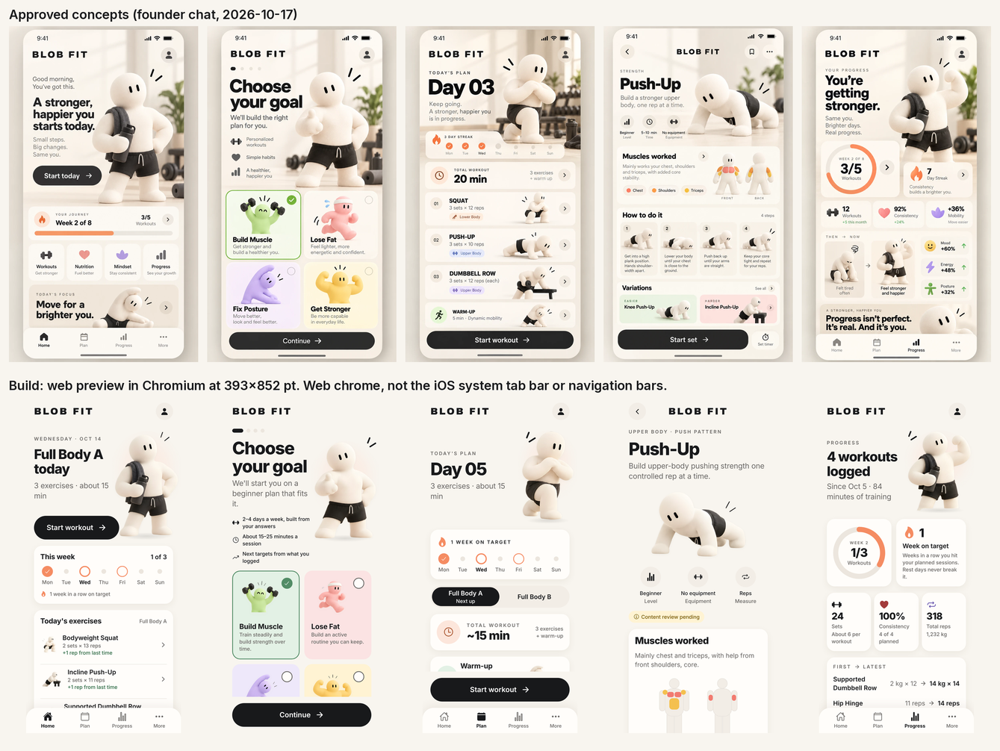

# BLOB FIT — MVP implementation report

**Branch:** `claude/zealous-cannon-9cvkob` · **Date:** 2026-10-18 · **Status:** feature-complete MVP preview. This is not an app-store release.

**Web preview:** https://onderhalis.github.io/blobfit/ (the exported web build; not the native app). See [Web preview](#web-preview) and, for iPhone, [`NATIVE_TESTING.md`](NATIVE_TESTING.md).



All main screens: [`screenshots/all-screens-393.png`](screenshots/all-screens-393.png). Smallest supported phone: [`screenshots/concept-vs-build-320.png`](screenshots/concept-vs-build-320.png).

## Run it

```bash
npm install
npm run web          # Expo dev server in the browser
npm run ios          # Expo Go / simulator (macOS)
npm run android      # Expo Go / emulator
npm run check        # typecheck + lint + unit tests
npm run build:web && npm run e2e   # exported web build + end-to-end smoke test (Playwright)
```

Stack: Expo SDK 58, React Native 0.88, React 19.3, TypeScript 6 (strict), Expo Router (file routes in `src/app/`). Everything runs offline. There is no account, backend, API key, analytics or payment code.

## What works

| Area | Behaviour |
|---|---|
| **Onboarding** | Four steps: goal, experience, training days (2–4, with a warning for three days in a row), equipment, plus a required general-fitness disclaimer. The answers persist across relaunch and can be edited later in *More → Your plan settings*. |
| **Home** | Today's date and plain status from real state ("Full Body B today", "Rest day", "Done for today", "… in progress") with one action. Below: this week (done vs planned, streak), today's or the next workout with each exercise's target and what changed since last time, and the last workout. |
| **Plan** | Beginner full-body A/B rotation. A is squat, incline push-up and a pull; B is hip hinge, a pull and plank. Sets depend on experience. The pull adapts to equipment: dumbbell row, then band row, then prone Y raise. The screen also has week dots (done / planned / missed / rest / extra), a ~duration estimate, an expandable warm-up and A/B preview. Rest days are real days off, and you can still start a workout if you want. |
| **Exercise detail** | Visual first:<ul><li>the movement itself: the two key positions loop, tap to pause, side by side with Reduce Motion;</li><li>three key points;</li><li>each common mistake as a picture with its name and a one-line fix;</li><li>a muscle map and linked easier/harder variations.</li></ul>No long text: the full coaching notes (setup, steps, tempo, breathing, form checks by camera view, why each mistake matters) stay in `data/exercises.json`. They feed the illustrator's brief and the coach review, but they are not shown in the app. Every exercise shows a **Content review pending** badge. |
| **Library** | 51 movements in seven groups: squat, single leg, hinge, push, pull, core, arms and shoulders. It has search (name, muscle, movement family or equipment), equipment filters and a level tag on each row (starter / beginner / next step). Exercises that need equipment you didn't select are flagged. |
| **Workout logging** | Per-set reps or seconds and load (kg/lb), done ticks, add/remove sets, skip, swap to a same-pattern exercise your equipment allows, a persistent timer with pause/resume, a 60 s rest countdown and a warm-up checklist. Each exercise shows what you did last time and why today's target is what it is; after its last set it asks how it felt (easy / just right / hard). Discarding asks for confirmation. Only ticked sets are saved. |
| **Session summary** | Duration, sets, reps, hold time, volume, new personal bests compared only with your own earlier sessions, how each exercise felt, and the next target for each. Delete also asks for confirmation. |
| **Progress** | All numbers come from logs (per-side exercises count both sides): workouts and minutes since the first one, this week's ring, weeks-on-target streak, sets, consistency (completed ÷ scheduled days so far), total reps/volume, first-vs-latest best set (like-for-like only), a six-week training calendar, personal bests and recent sessions. A brand-new user sees no zero tiles, only this week's target and their first workout. |
| **More** | Plan settings, library, safety & about, kg/lb, training-day reminder (iOS/Android only, off by default), and erase all data (with confirmation). |
| **Robustness** | Loading state. Saved data is validated down to every set: unreadable or incomplete data shows a recovery screen and is never silently wiped. A failed write to device storage shows a *Not saved* banner with retry. Schedule edits apply from the day they are made, so past weeks keep their original targets. Safe areas respected. 44 pt minimum touch targets. Screen-reader roles, labels, values and states on all controls (cross-platform `aria-*` props, so checked/selected/disabled states also reach the web). Every progress ring and bar also has a text value. There are no animations, so reduced-motion settings are honoured by default. |

## Quality gates (`docs/QUALITY_GATES.md`)

| # | Gate | Result | Evidence |
|---|---|---|---|
| 1 | install / typecheck / test / lint | ✅ | `npm run check`: tsc clean, eslint 0 problems, **111 unit tests** pass (also run under `TZ=America/New_York` and `TZ=Asia/Tokyo`), plus the exercise content rules and an up-to-date art brief. |
| 2 | App starts, five screens navigable | ✅ web · ⚠️ native | Web: exported build driven end to end by `e2e/smoke.mjs`. Native: `expo export --platform ios --platform android` bundles successfully. No simulator or device was available, so native runtime is **unverified**. |
| 3 | Onboarding persists across relaunch, editable | ✅ | e2e reloads after onboarding and after logging; the preferences screen saves edits. |
| 4 | Safe rest days, no fake metrics | ✅ | Schedules are limited to 2–4 days and every default has rest days between sessions (unit tested). The concept numbers are not used anywhere. |
| 5 | Complete a workout end to end, progress updates | ✅ | e2e logs 4 sessions across 2 simulated weeks, then checks the progress screen after a relaunch. It also covers a plan started on a Saturday (first session Monday) on a fresh device. The reducer flow is also unit tested. |
| 6 | Instructions + review disclaimer | ✅ | Unit test asserts every exercise has muscles, ≥3 steps, ≥2 mistakes, phases, cues, easier/harder and `needs-qualified-review`. |
| 7 | Blob identity / no competitor art | ✅ | Interim art is cut out of the approved concepts only. See `assets/illustrations/interim/README.md`. |
| 8 | Screen reader labels, contrast, phone sizes, safe area | ✅ contrast · ⚠️ VoiceOver/TalkBack | WCAG AA contrast is unit tested for every text/background pair. Labels and roles are set throughout. A real VoiceOver/TalkBack pass on device is **not done**. |
| 9 | No backend / subscription | ✅ | No network code. Dependencies are Expo modules, AsyncStorage, react-native-svg, Google Fonts packages and dev tooling. |
| 10 | Summary, tests, gaps, screenshots, commands | ✅ | This document and `docs/screenshots/`. |

Other checks: `expo-doctor` passed 18/20. The 2 failures need the Expo API, which this container's network policy blocks.

## Decisions taken (approved by ChatGPT for the MVP, see `docs/DECISIONS.md` · CC-002)

1. **Tabs:** Home · Plan · Progress · More, as in the concepts. Library and settings live under More.
2. **Accent:** peach `#F58C62`, following `DESIGN_SYSTEM.md` and `DECISIONS.md`. The cobalt in the Visual Bible stays with social content.
3. **Streak** = consecutive weeks with the planned sessions done. Rest days can't break it.
4. **Not shown:** 92% consistency, +36% mobility, mood/energy/posture deltas and "Week 2 of 8". None of these are measured. The "Then → Now" panel compares the user's first and latest logged best sets instead.
5. **Variation fix:** the concept labels the incline push-up as *harder*. The app treats it as *easier*.
6. **Goal copy:** "Fix Posture" became **Move Better**, and "Lose Fat" copy makes no outcome promise.
7. **Persistence:** a versioned AsyncStorage document with a migration hook. This is a deliberate deviation from the SQLite suggestion in `ARCHITECTURE.md`: it behaves identically on iOS, Android and web (web is the only runtime testable here), and the domain layer is storage-agnostic, so a later swap is contained.
8. **Prescriptions** (sets, reps, holds, A/B split) are starting points pending qualified review.

## Design QA round (issue #4, CG-IOS-001)

Side-by-side sets: [393×852](screenshots/concept-vs-build-393.png) and [320×568, the smallest supported phone](screenshots/concept-vs-build-320.png). Both are the exported **web** build in Chromium, not an iOS simulator.

- **Small phones:**
  - A shared `Hero` scales the Blob art with the screen width and never lets it cover text.
  - Headlines size themselves so their longest word fits, so 320pt phones no longer break "Wednesday" mid-word.
  - There are no negative-margin overlaps (Home CTA, Plan week card, Progress cards).
  - On 375pt phones and with large Dynamic Type, the quick links become 2×2 and the stat tiles reflow. On 320pt the ring and streak cards stack.
- **iOS-native details:**
  - SF Symbols via `expo-symbols`, with an explicit mapping in `src/components/Icon.tsx`; Android and web keep Ionicons.
  - System alerts for confirmations, with the destructive style for discard and erase.
  - `ActionSheetIOS` for exercise swaps.
  - Light haptics on set completion and a success haptic on finishing.
- **Exercise detail:** a simplified front/back muscle map (main muscles red, supporting yellow), labelled *pending coach review*.
- **Regression guard:** the e2e smoke test also runs at 320×568 in CI (`E2E_VIEWPORT`).

## Native iOS round

iOS now uses the system chrome. Android and the web keep the custom chrome, which the e2e tests and the web preview exercise.

| Area | iOS | Android / web |
|---|---|---|
| Tabs | `NativeTabs` (UITabBarController, Liquid Glass on iOS 26) with SF Symbols, `(tabs)/_layout.ios.tsx` | Floating custom tab bar |
| Pushed screens | Native navigation bar, back chevron, edge swipe-back | Custom top bar with back button |
| Workout | Sheet; swipe down minimises it (it stays saved) | Full screen, minimise button |
| Insets | UIKit automatic scroll insets (status bar, nav bar, tab bar, home indicator) | Safe-area insets applied by hand |
| Confirmations, swap, units | System alert, action sheet, UISegmentedControl | Modal sheet, inline list, pill control |
| Icons | SF Symbols (explicit map, unit-tested) | Ionicons |

Also in this round:
- **Art:** the interim cut-outs are upscaled 2–4× (Real-ESRGAN, same art, nothing redrawn) and served as WebP, so they are sharp on 3× screens. See `assets/illustrations/interim/README.md`.
- **Hero:** Blob sits on a soft warm glow with a floor shadow, as in the concepts' sunlit studio.
- **Onboarding:** the goal step uses the shared hero and the concept's three promises.
- **Plan rows:** title-case names, a smaller badge and thumbnail, one-line tags; nothing breaks mid-word, even at 320pt.
- **Tests:** headline fitting has unit tests.
- **EAS:** `eas.json` and a bundle identifier are added; `docs/NATIVE_TESTING.md` covers Expo Go, the Simulator, EAS and TestFlight.

**Not verified:** none of the iOS-only paths has run on a simulator or device. This container has no macOS. They are type-checked and bundle for iOS and Android.

## Web preview

https://onderhalis.github.io/blobfit/ is served from the `gh-pages` branch (published with the founder's approval).

- **Publish:** `tools/preview/deploy-pages.sh` builds the committed, pushed source for the `/blobfit` sub-path. It adds a page per route so deep links return 200, and commits the result to `gh-pages` with `preview.json`, which records the source commit and build id.
- **Verify:** every deploy runs the "Verify web preview" workflow on `gh-pages`. It waits until the live URL serves that build id, then runs the full Playwright smoke test against the **live HTTPS URL** at 390×844 and 320×568 from a GitHub runner.
- **Limits:** data stays in the visitor's browser (`localStorage`). There is no backend, analytics or account. It is the web build, so it shows the web chrome (custom tab bar and top bars), not the iOS system UI.

Still open:
- Step-by-step pose images and exercise-specific art: requested in issue #1 (CC-007, CC-009).
- TestFlight / EAS: needs the founder's Apple Developer and Expo accounts.

## Training round: what successful fitness apps do

Founder feedback (2026-10-18): parts of the app read as generic AI output. This round removes that and adds the features that the best-known training apps share, inside BLOB FIT's own design. Every number shown comes from the user's own logs.

**Removed:** slogans and affirmation copy, Home quick-link tiles that repeated the tab bar, the generic "Today's focus" tip, zero-value tiles for new users, the slogan footer on Progress, and repeated text (two "no workouts" messages; a workouts tile that repeated the headline).

| Pattern in established apps | In BLOB FIT now |
|---|---|
| Previous performance inline while logging (Strong, Hevy) | "Last time (Oct 9): 12, 12 reps · 8 kg" under every exercise, plus a per-exercise history on the exercise screen. |
| Automatic progressive overload (Fitbod, Jefit, Progress) | Double progression from your own last session (`src/domain/progression.ts`). Reps: +1 per session (+2 if it felt easy). Bodyweight goes up to target +4, then suggests the harder variation if your equipment allows. Loaded: up to target +2 reps, then +2 kg (5 lb) is *offered*: the workout keeps last time's load until the user taps "Use N kg" (founder decision, 2026-10-19, after ChatGPT's CC-010 review). Harder variations are only suggested, never swapped in automatically. Holds: +5 s (+10 s if it felt easy). Missed reps or "hard" repeat the target. Never below the plan. Each change states its reason. |
| Effort rating (RPE in Strong/Hevy, "how did it feel" in Fitbod) | Easy / just right / hard after each exercise; it feeds the next target. |
| Next-time targets | Session summary lists the next target per exercise; Plan and Home show the progressed prescription. |
| Consistency calendar (Apple Fitness, Hevy) | Six-week training calendar on Progress (trained, extra, planned, missed, rest). It replaces the weekly bar chart. |
| Workout reminders | Opt-in, one local notification per training day at a chosen hour. Nothing leaves the device. |
| Rest timer (Strong) | Already present: 60 s countdown after each set. |

Not added yet, and why:
- **Apple Health, widgets, Live Activities:** need a development build and a device to verify; Expo Go cannot run them.
- **Focus mode (one exercise per screen):** a reasonable next step; it needs device testing of gestures and VoiceOver order first.
- **Plate calculator:** the plan uses bodyweight, bands and dumbbells; there is no barbell yet.
- **Badges, social feed, AI coach chat:** easy to make look busy without helping a beginner; left out on purpose.

Tests: `src/domain/__tests__/progression.test.ts` covers the rules above; the e2e smoke test logs four sessions and checks "Last time", the effort question, "Next time", Home's "from last time" line, the calendar and the new-user Progress state.

## Exercise library round

The founder asked for at least 40 movements, taught the way a coach teaches them, with Blob illustrations from Astra.

- **Content:** 51 exercises in `data/exercises.json`. The founder's original squat, push-up and row steps are kept word for word; their original mistakes are now titles with full explanations.
  - **Schema:** `src/domain/types.ts`. It has `formChecks` (camera view plus what to check), `mistakes` (`title`, `view`, `looksLike`, `why`, `fix`), `breathing`, `safety`, `level` and `artBrief`.
  - **Rules:** `tools/content/exercise-rules.cjs` covers field lengths, the muscle vocabulary, links (an easier variation is never at a higher level), at least 40 exercises and at least 4 per group. It also rejects claims about injury prevention, cures, fat burning and "toning". The unit tests and `npm run content:check` both run it.
  - **Review:** everything is still `needs-qualified-review`. Angle numbers in the mistakes (for example "elbows near 90°, a T") are coaching estimates for spotting faults on video, not measured thresholds.
- **Swaps:** a workout swap stays within the same movement family and the same measure, so a timed hold never replaces a rep exercise.
- **Art pipeline:**
  - **Brief:** `docs/EXERCISE_ART_BRIEF.md` is generated from the data (`npm run art:brief`). It lists 257 images in three batches (the beginner plan first), each with its file path, camera view and pose. The delivery checklist updates itself.
  - **Sync:** after Astra uploads to `assets/exercises/<id>/`, `npm run art:sync` checks each PNG (transparency, size, padding, a known id and mistake number) and writes optimized WebP copies. It also regenerates `src/components/exerciseFrames.ts`. The detail screen then shows the start and end frames side by side, and each mistake image next to its fix.
  - **Request:** issue #1, CC-011 to CC-014 and CC-017. `npm run art:sync` puts every frame of an exercise on one shared scale and ground point, so generated images don't need pixel-exact alignment.
  - **One sheet per exercise (founder, 2026-10-19):** single images arrived with a different camera, arms or props in each frame, and every file needed its own message. Now `docs/art-prompts/batch-<n>.md` has one prompt per exercise: one transparent image with a 3 × 2 grid (start, end, mistakes). `npm run art:import` (`tools/art/import_sheets.py`) cuts a sheet into the per-file frames, keeping one scale for the whole sheet, and then runs `art:sync`. A sheet can be pasted into the Claude chat or uploaded to `assets/exercises/inbox/`. That is 49 images instead of 247 for what is left. Each frame is smaller (about 500 px instead of 1024), so the loop is a little softer on 3× screens.
  - **Release gate:** `npm run release:check` fails while any of the 257 images is missing, so the app does not ship with exercise art gaps.
- **Visual first (founder, 2026-10-19):** "People learn exercise by looking at it or watching it."
  - The detail screen now shows the movement (start and end frames, looping), three key points, and each mistake as a picture plus a one-line fix (`mistakes[].cue`, 40 characters max).
  - The longer coaching text is kept as source material for the art brief and the coach review.
  - Mistakes that a still picture can't show were replaced or dropped in the beginner plan: row "Jerking weight" became "Rounding the back", plank "Holding your breath" became "Head hanging down", and band row lost "Letting the band snap back". The hip hinge is drawn with hands on hips instead of a dowel. Batch 2 and 3 still have a few timing mistakes ("Rushing the reps", "Moving too fast"); they get the same treatment before those sheets are requested.
- **Not done:** 10 of 257 images are in (squat and incline push-up). The rest of the library shows the interim concept crops (split squat, push-up variations, row) or a neutral icon.

Screens (web build): [library](screenshots/09-library.png) and [search](screenshots/09b-library-search.png) at 393pt; [incline push-up detail](screenshots/exercise-detail-320.png) at 320pt.

## Known gaps and placeholders

- **Art is interim.** The mascot cut-outs come from 941×1672 concept images. They are upscaled for 3× screens, but they are not production exports. Hip hinge, glute bridge, plank, box/goblet squat, RDL, band row and prone Y raise have no approved pose, so they use a neutral icon tile. Production exports are requested in issue #1 (`CC-001`).
- **Canonical asset PNGs** (11 files in `docs/ASSET_MANIFEST.md`) are still not on GitHub.
- **Native runtime** has not been run on a simulator or device. The iOS-only paths (system tab bar, navigation bars, sheet, automatic insets, SF Symbols, alerts, action sheet, segmented control, haptics) are type-checked and bundled but not exercised. The quickest check is Expo Go; see `docs/NATIVE_TESTING.md`.
- **Reminders are local and native-only.** The web preview has none. There is still no data export and no dark mode. Dark mode is out of scope for the cream visual direction; `userInterfaceStyle` is locked to light.
- **Copy review:** exercise text, the disclaimer and prescriptions need a qualified coach and legal review before any public release.
- The working name "BLOB FIT" is pending trademark/app-store clearance. The app icon is a simple placeholder drawn from the canonical face.

## Where things live

```
src/app/           routes (onboarding, (tabs)/index|plan|progress|more, exercise/[id], workout, session/[id], library, preferences, about)
src/domain/        pure, tested logic: plan, session, progress, state reducer, storage
src/components/    design-system components
src/theme/         tokens (+ contrast tests)
data/exercises.json  exercise catalog (original 3 entries kept, 9 added)
e2e/               static server + Playwright smoke test
```
